# Lab 3 — District Dashboard: report

**GIS874 Web GIS**
Institute of Geographical Information Systems
School of Civil and Environmental Engineering
National University of Sciences and Technology, Islamabad

| | |
|---|---|
| Name | Zaid Younas |
| Reg # | 537865 |
| Submitted to | Dr. Shahid Nawaz Khan |
| Repository | https://github.com/zayd0123/webgis-lab-537865 |
| Lab 2, still published | https://zayd0123.github.io/webgis-lab-537865/ |
| Live dashboard | https://zayd0123.github.io/webgis-lab-537865/lab3/ |
| Canvas version | https://zayd0123.github.io/webgis-lab-537865/lab3/index.html?canvas |

---

## 0. One thing the lab text cannot know: the Carto basemap now needs a key

Part 3 specifies Carto Positron as the default basemap, and the `{y}/{x}`
distinction in the Esri template as the thing to read carefully. The Esri
template is fine. **Positron is not.**

Since the handout was written, Carto has put its basemaps behind an API key.
`https://{s}.basemaps.cartocdn.com/light_all/{z}/{x}/{y}{r}.png` now returns a
256 × 256 placeholder tile reading **"API KEY REQUIRED — carto.com/basemaps/apikey"**.
It is a `200 OK`, not an error: there is nothing in the console, and the tile
even carries `access-control-allow-origin: *`, so nothing about the request
looks wrong. The map simply draws that watermark where the basemap should be.

Carto's own documentation now states that basemaps require a key, and other
projects have hit the same wall. Verified on 12 October 2026:

| Basemap | Endpoint | Result |
|---|---|---|
| Carto Positron | `{s}.basemaps.cartocdn.com/light_all/...` | 200, 2,049-byte **API KEY REQUIRED** tile |
| Carto, no subdomain | `basemaps.cartocdn.com/light_all/...` | same placeholder |
| Carto Voyager | `.../rastertiles/voyager/...` | same placeholder |
| Stadia Alidade Smooth | `tiles.stadiamaps.com/...` | **401** |
| OpenStreetMap | `tile.openstreetmap.org/{z}/{x}/{y}.png` | 200, real tile |
| Esri World Imagery | `server.arcgisonline.com/.../tile/{z}/{y}/{x}` | 200, real tile |

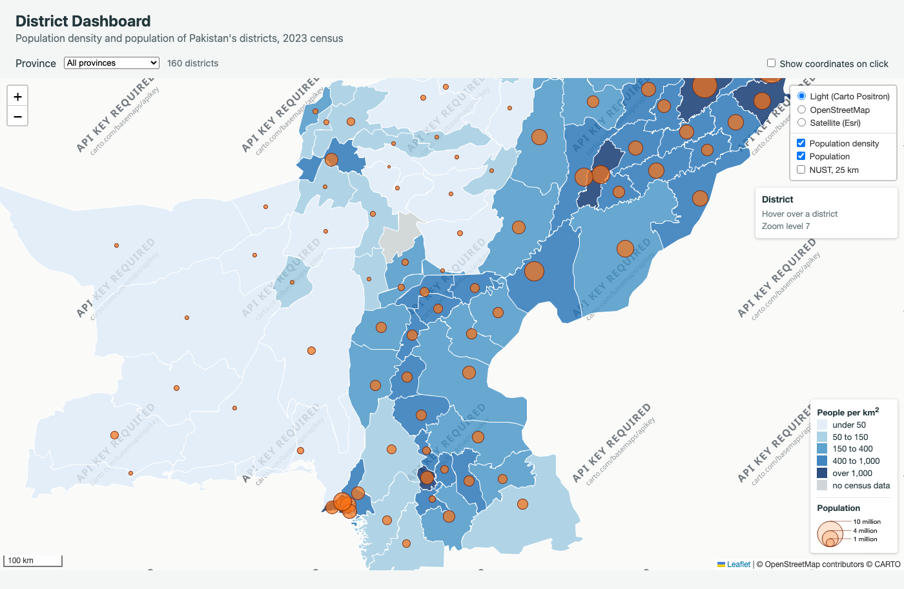

*The page unmodified, with the default basemap Carto Positron. Every tile is
the "API KEY REQUIRED" placeholder.*

**What I did about it.** The lab is marked on Part 3's three basemaps, so
`lab3/app.js` keeps all three exactly as the handout publishes them — the same
URLs, the same `subdomains: 'abcd'`, the same attribution strings — and a short
comment at that block records the finding. Nothing is hidden. To make the rest
of the screenshots legible, the figures below were captured with
**OpenStreetMap** selected in the layer control; the density shading, the
circles, the info panel and the legend are identical either way, and the last
figure in this section shows the same dashboard over satellite imagery.

The alternative, if the watermark is not wanted on the published page, is a
one-line change to an equally quiet key-free basemap — Esri's Light Gray Canvas
(`.../Canvas/World_Light_Gray_Base/MapServer/tile/{z}/{y}/{x}`) is the closest
match to Positron's grey-and-quiet look, and it is also an Esri service, so the
`{y}/{x}` lesson still applies. I have left the code faithful to the lab rather
than make that substitution unasked.

---

## 1. Setting up the project

Working in the same repository as Lab 2, so that Lab 2 stays published at the
repository root. Lab 3 is a new folder beside it:

```
webgis-lab-537865/
├── index.html          ← Lab 2, unchanged
├── style.css
├── app.js
├── data/districts.geojson
├── report.md
├── Report/
└── lab3/               ← this lab
    ├── index.html
    ├── style.css
    ├── app.js
    ├── report.md       ← this file
    ├── data/
    │   ├── districts.geojson
    │   └── district_points.geojson
    └── Report/
```

`lab3/data/districts.geojson` is the Lab 2 layer copied across, and is
byte-for-byte the same file: 160 features, 915,980 bytes, five attributes
(`district`, `province`, `pcode`, `pop_2023`, `area_km2`).

Served with Live Server, the address bar ends in `/lab3/index.html`, and the
data paths are relative to that file. Locally that is
`python3 -m http.server`, then <http://127.0.0.1:5511/lab3/index.html>.

---

## 2. The point layer

Population is drawn twice in this lab: as a density on the polygons, and as a
circle per district. The circles need a point per district, so the layer was
built with QGIS's two geometry tools and exported as the handout specifies.

| | |
|---|---|
| File | `lab3/data/district_points.geojson` |
| Tool | QGIS 4.2.3, **Vector ▸ Geometry Tools ▸ Point on Surface** (`native:pointonsurface`) |
| Features | **160** (confirmed in the attribute table) |
| Size | **53.8 KB (55,113 bytes)** |
| CRS | EPSG:4326 |
| COORDINATE_PRECISION | 5 |
| Attributes | all five inherited from the district, including `pop_2023` |
| Points falling outside their own district | **0 of 160** |

This was done in QGIS itself, by calling the same Processing algorithms the
menus call, and the whole thing is reproducible:
`lab3/make_point_layer_qgis.py` writes the layer the page fetches, and
`lab3/qgis_part2.py` runs both tools, checks the result, and exports the figure.
`lab3/QGIS.md` has the commands and the by-hand GUI route.

### The district whose centroid falls outside it

> **Sibi**, in Balochistan. Its centre of mass falls **0.02402° (about 2.7 km)
> outside** its own boundary, inside **Harnai**.

Sibi is a crescent, with a long narrow arm reaching north-east. The balance
point of that shape falls in the notch on the western side, in the neighbouring
district, rather than in the body of Sibi. One district in 160 does this. The
next closest are Nagar (0.0093° *inside*) and Nankana Sahib (0.0119° *inside*),
so Sibi is not a marginal case — it is the only one.

**Checkpoint 2 — QGIS, both points on Sibi**

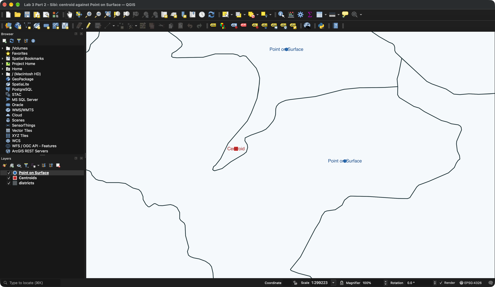

*The QGIS application itself. The Layers panel lists the three layers with
**Centroids** (red square) and **Point on Surface** (blue dot) ticked above the
district boundaries, and the canvas is framed on the two points at 1:299,223:
the red square sits in Harnai on the far side of the boundary, the blue dot
inside Sibi. Captured from the running application by
`lab3/capture_qgis_app.sh`, which opens `sibi_centroid_map_view.qgz` — that
project carries the styles, the labels and the canvas extent, so it opens
looking like this with nothing to set up by hand.*

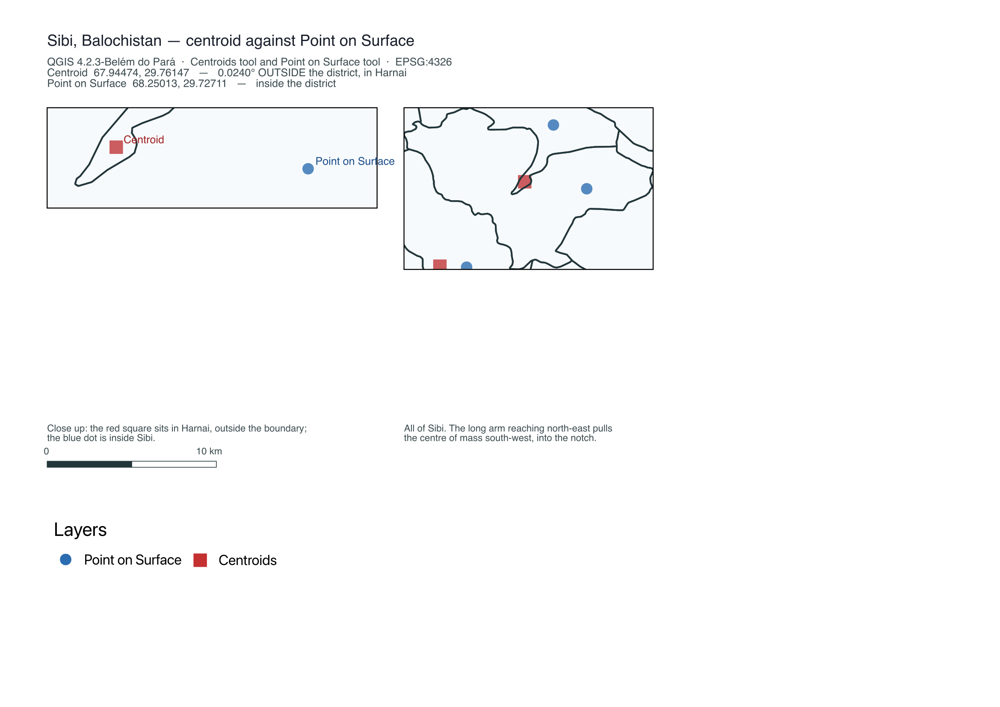

*The same two layers through a QGIS print layout: the close-up on the left, and
on the right the whole district, where the cause is visible — the long arm
reaching north-east pulls the centre of mass south-west into the notch. The
scale bar reads 10 km.*

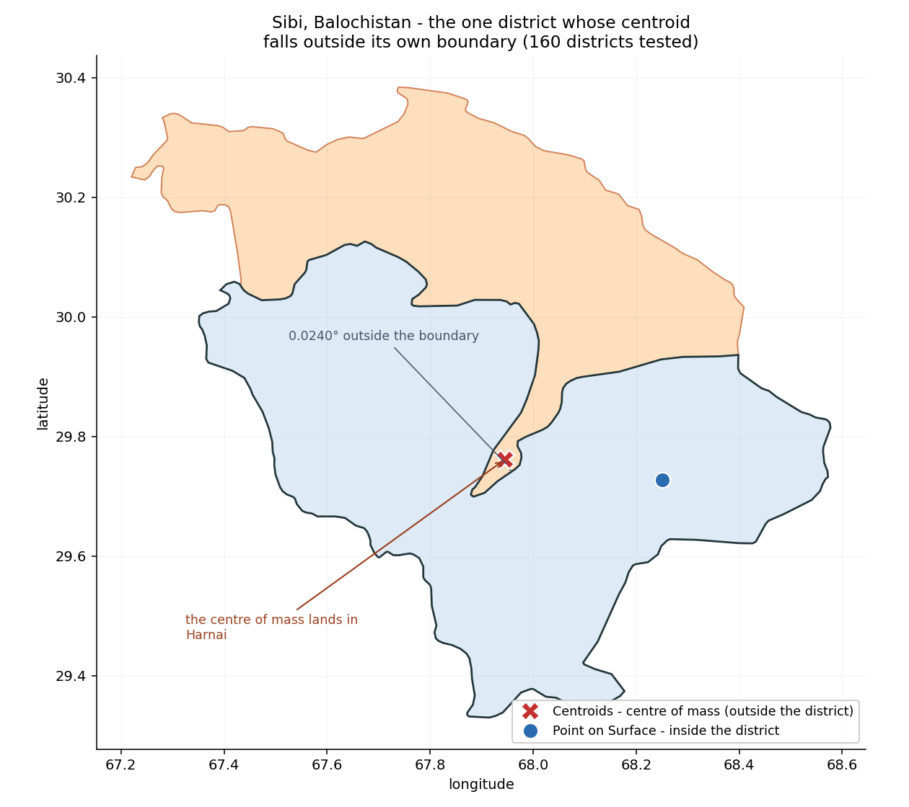

*The same two QGIS layers, drawn with matplotlib, annotating the 0.02402°
overshoot directly.*

### Why the layer is not shapely's `representative_point()`

The first version of this layer was built with shapely, assuming QGIS's Point on
Surface and shapely's `representative_point()` were the same point. **They are
not, and the gap is large:** shapely uses the pole of inaccessibility — the
centre of the largest circle that fits inside the polygon — while QGIS's
algorithm is a different construction. On Gwadar, whose coastline is deeply
concave, **the two land 0.877° apart**, and running QGIS's own algorithm moved
**all 160** of the earlier points.

So the committed layer is QGIS's output rather than an approximation of it, and
`qgis_part2.py` checks the two against each other every time it runs. The
largest remaining difference is **0.00000704°** (Jhelum Valley), which is the
5-decimal rounding and nothing else.

```
$APP/Contents/MacOS/python lab3/make_point_layer_qgis.py   # rebuilds the file in QGIS
$APP/Contents/MacOS/python lab3/qgis_part2.py              # both tools + Checkpoint 2 figure
python3 lab3/check_point_layer.py                          # prints the Sibi evidence
```

### Three QGIS 4 behaviours worth knowing

Each of these produced a wrong figure before it was understood, and each is
worked around in `qgis_part2.py`:

1. **A `Cross`/`Cross2` marker renders only its stroke** and ignores its fill, so
   a red cross with a white outline draws **white** — invisible on a white page,
   and apparently empty in the legend. The figure uses a red **square** instead.
2. **`QgsLayoutItemMap` does not inherit the project's layers.** Without an
   explicit `setLayers()`, the layout exports blank frames even when the layers
   are in the project.
3. **`QgsLayoutItemScaleBar` collapses in PyQt6.** It sizes segments through
   `QSizeF`, which is integer-based there, so a 25 mm segment rounds to 25
   *pixels*: the bar draws at no width and its numbers overlap
   (`5,000 10,000 m`). The figure draws the bar from the map's own scale — at
   1:397,892, 10 km is 25.13 mm.

---

## 3. The page, the map and its basemaps

Every setting goes into the options object rather than into a `setView` call
after the fact, so the map is never unconstrained, not even on the first frame.

| Option | Value | Why |
|---|---|---|
| `center` / `zoom` | `[30.3753, 69.3451]`, 5 | the whole country fits |
| `minZoom` | 5 | further out shows only the neighbours |
| `maxZoom` | 14 | boundaries simplified to ~100 m stop looking right before street level |
| `maxBounds` | `[[21.5, 58.5], [39.0, 80.5]]` | Pakistan with about two degrees to spare |
| `maxBoundsViscosity` | 1.0 | the bounds are solid, not springy |
| `preferCanvas` | `useCanvas` | Part 9 |

The three basemaps and the layer control (see §0 for the Carto situation), plus
`L.control.scale({ imperial: false })`. The second argument to
`L.control.layers` is left empty and filled in by Parts 4 and 6, which is why
the control is kept in the variable `layerControl`.

**Checkpoint 3 — the Esri tile URL**

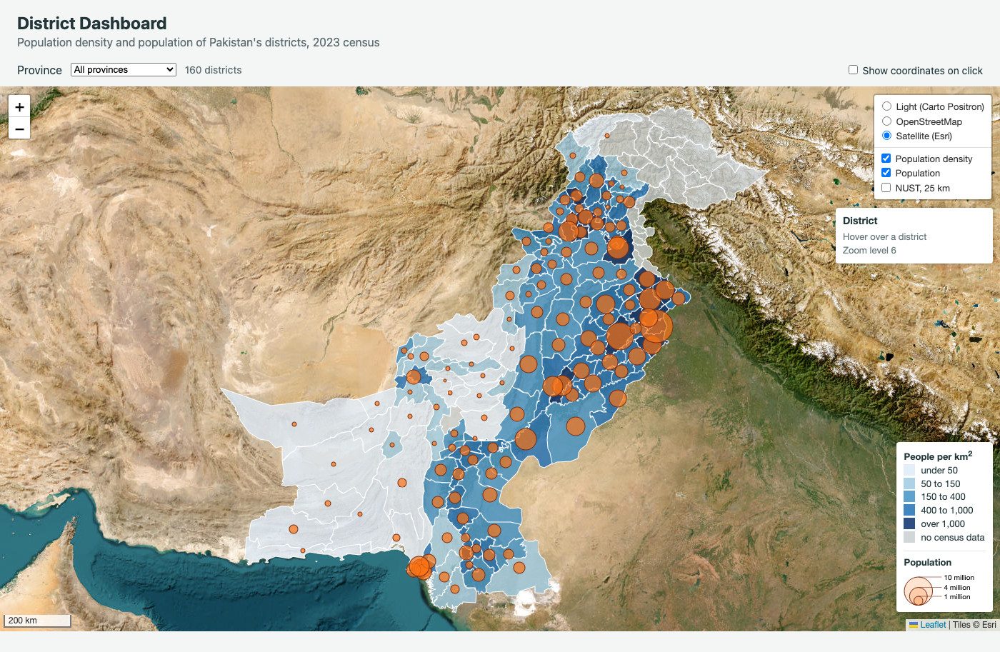

*The Esri World Imagery basemap, selected in the layer control. The browser
requested tiles such as*

```
https://server.arcgisonline.com/ArcGIS/rest/services/World_Imagery/MapServer/tile/6/26/44
```

**In `{z}/{y}/{x}`, the first number after the zoom is the row and the second
is the column. So `6/26/44` is zoom 6, row 26, column 44.**

The template reads `{y}/{x}` — row first, then column — which is the reverse of
the OSM and Carto templates, where `{x}/{y}` puts the column first. Checked
against the geography: at zoom 6, moving south from Islamabad (row 25) to
Karachi (row 27) *increases* the row, and moving east from Quetta (column 43) to
Lahore (column 45) *increases* the column. Row tracks latitude, column tracks
longitude. Leaflet substitutes whatever placeholders the template contains, in
the order they appear, which is why the provider's string has to be copied
exactly — swapping the two gives a satellite view of the wrong place rather than
an error. Verified two ways: computed from the Web Mercator projection for seven
Pakistani cities, and by reading the requests Chrome actually made, below.

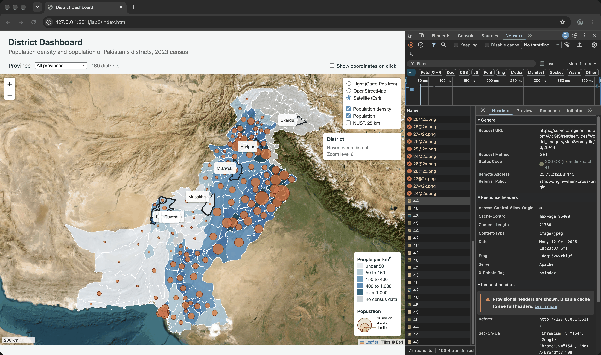

*Chrome's own Network tab, not a mock-up: the dashboard is on the **Satellite
(Esri)** basemap, the panel is filtered to `arcgisonline`, and a tile request is
selected so that **Request URL** spells the whole address out underneath. The
screenshot is taken by `lab3/capture_devtools_network.mjs`, which opens the
panel with `Target.openDevTools {panelId: 'network'}`, sets the filter, selects
the row for a known tile, and captures the Chrome window with
`screencapture -l`.*

Reading it: the request is

```
https://server.arcgisonline.com/ArcGIS/rest/services/World_Imagery/MapServer/tile/6/25/44
```

and the last three path segments are `6 / 25 / 44`. Checked against the
geography, that tile covers northern Pakistan at zoom 6 — which is row 25,
column 44.

---

## 4. A thematic layer, done properly

### Why density and not population

Lab 2 shaded the districts by population. That map has a flaw, and the data
shows it plainly: Chagai covers 44,476.9 km² and holds 269,192 people, while
Central Karachi covers 65.1 km² — 683 times smaller — and holds 3,822,325.
Shading by the count makes Chagai a dark, prominent district purely because it
is enormous, and understates Central Karachi, which is the most crowded place in
the country at 58,715 people per km². A choropleth colours areas, so the value
behind the colour has to be one that does not grow with area. Density does not;
a count does. Population is still shown, as proportional symbols, in Part 6.

The rule, as the handout states it: **choropleth for densities, rates and
percentages; proportional symbols for counts. Never colour polygons by a count.**

### The shading

`densityOf()` computes the value from `pop_2023 / area_km2` every time a feature
is styled — density is deliberately not stored in the file, so the map cannot
disagree with the attributes. `colourFor()` then applies five breaks. Missing
data is handled before the breaks, not by falling through them: the 25 districts
with no census value are grey, which is a different statement from "thinly
populated".

The classification works out as **20 / 18 / 34 / 41 / 22** across the five
classes, plus the 25 grey districts — the same distribution the handout quotes
for its own copy of the data, which is a good sign that the join is right.
(Verified independently in `lab3/check_dashboard.mjs`.)

### The group, not the layer

`districtGroup` is an `L.featureGroup()` that goes into the control, while
`draw()` empties and refills it. Passing the `L.geoJSON` layer itself would work
until the first province change, after which the control would be pointing at a
layer that had been discarded and would switch nothing. `districts` is kept as a
separate variable for a different reason: `resetStyle` belongs to the
`L.geoJSON` layer, and Part 5 needs it.

### Loading

`Promise.all` starts both requests at once. Two `await`s in a row would fetch
the second file only once the first had arrived.

**Checkpoint 4 — the density map with its legend, and the layer control open**


*All 160 districts shaded by density, the population circles above them, the
layer control open showing three basemaps and three overlays, and the legend
showing both the density classes and the reference circles.*

**Checkpoint 1 — the project folder**

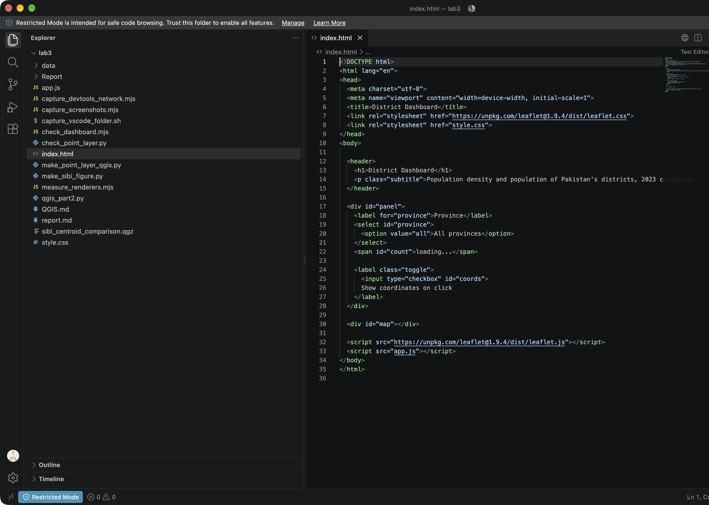

*VS Code with `lab3` open: `index.html`, `style.css` and `app.js` in the folder
root, `data/districts.geojson` and the point layer inside `data`, and
`index.html` open in the editor. Captured from the real application by
`lab3/capture_vscode_folder.sh`, which opens the folder with the `code` CLI and
captures the window with `screencapture -l`.*

---

## 5. Interaction: highlight and an info panel

A popup costs a click and covers the map; the panel reports whatever is under
the pointer for free. `info.onAdd` creates the div and — importantly — calls
`L.DomEvent.disableClickPropagation` and `disableScrollPropagation`, so that
clicking the panel does not also click the map beneath it and scrolling over it
does not zoom. Part 7 step 2 shows what the first of those is for.

`info.update` is an ordinary method added to the control. Leaflet calls `onAdd`
once; nothing calls `update` until this code does, and called with no argument it
restores the resting message.

The three handlers passed to `layer.on` are shared by all 160 districts.
`highlight` thickens the outline and calls `bringToFront()`, without which the
thick border is half hidden under the neighbouring polygons. `unhighlight` calls
`districts.resetStyle(e.target)`, which re-runs `styleFor` for that one feature,
so the original colour never has to be stored anywhere.

**Checkpoint 5 — hover highlight, tooltip and info panel**

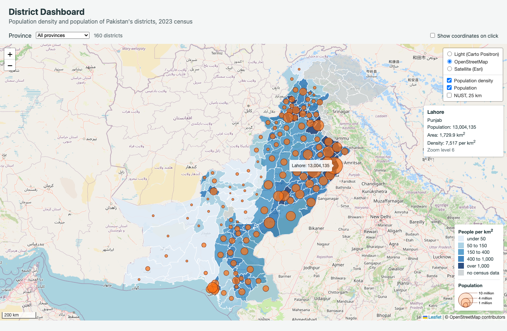

*Lahore: the outline thickened to weight 3, the sticky tooltip showing the
population, and the info panel reporting the district, province, population,
area and density, with the current zoom level underneath.*

---

## 6. Proportional symbols in their own pane

### The pane

Polygons and circle markers are both vector paths, so both would go into
`overlayPane` and whichever was drawn later would cover the other — and
`bringToFront()` on hover would lift a district above the circles. A pane at
z-index 450 sits above `overlayPane` (400) and below `markerPane` (600), so the
circles are above every polygon and below tooltips and popups, settled once
rather than per hover.

### The square root

```
radiusFor(population) = Math.sqrt(population) / 160
```

The eye compares the **area** of a circle, and area grows with the square of the
radius. Lahore's 13,004,135 people give a radius of 22.5 px, which is what the
handout predicts. Verified from the live layer: a district with 5.01 times the
population of another is drawn 5.01 times the area, not 5.01 times the radius.

### The filter

`pointToLayer` turns each point into a `circleMarker` instead of the default
pin, and `hasPopulation` removes the 25 districts with no census value *before*
anything is drawn, so `circleFor` never meets a null and never calls
`.toLocaleString()` on one. 135 of the 160 points survive the filter and 135
circles are drawn.

### Metres or pixels

`L.circle` takes its radius in metres, so it is a fixed patch of ground;
`L.circleMarker` takes pixels, so it is a fixed patch of screen. Measured on the
NUST overlay at five zoom levels:

| Zoom | 25 km `L.circle`, diameter on screen | 6 px `L.circleMarker`, diameter on screen | Scale bar | The circle spans |
|---|---|---|---|---|
| 5 | 12 px | 12 px | 300 km | 50,000 m |
| 6 | 24 px | 12 px | 200 km | 50,000 m |
| 8 | 98 px | 12 px | 50 km | 50,000 m |
| 10 | 394 px | 12 px | 10 km | 50,000 m |
| 14 | 6,292 px | 12 px | 500 m | 50,000 m |

The one figure that never changes is the last: the `L.circle` always covers
exactly 50 km across, whatever the zoom, because it is tied to the ground. Its
size on screen grows 524-fold from zoom 5 to zoom 14. The `circleMarker` covers
12 px of screen at every zoom, which is a different and much larger amount of
ground as you zoom out.

**Checkpoint 6 — the dashboard with both legends, and NUST at two zooms**

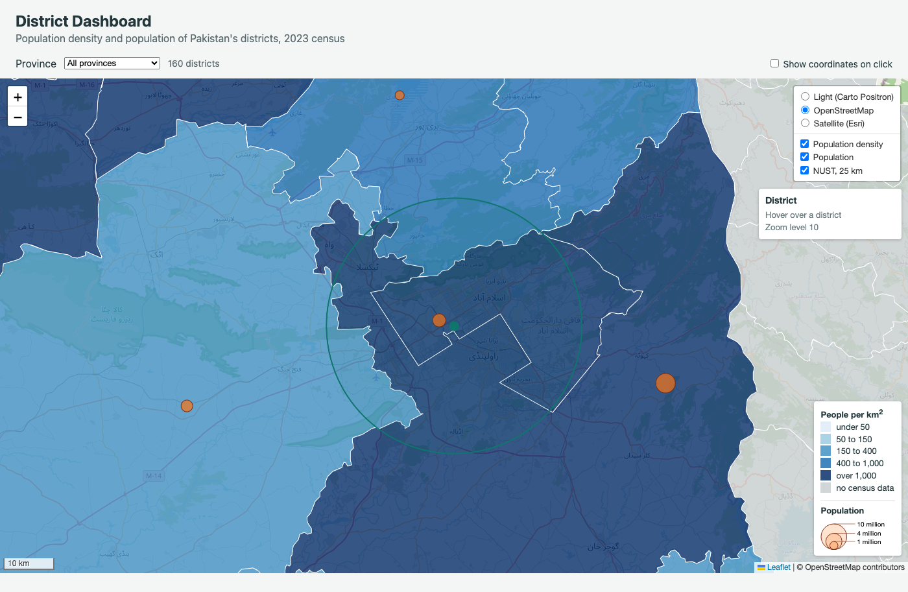

*Zoom 10: the 25 km circle is nearly 400 px across and the 6 px campus marker
sits inside it. Against the 10 km scale bar the circle measures a little over
two and a half bar-lengths, which is the 25 km it should be.*

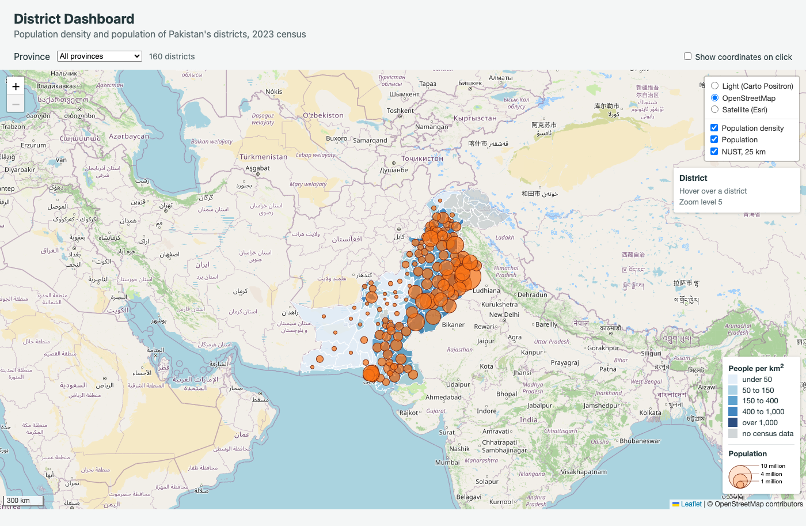

*Zoom 5: the same circle is 12 px across and the campus marker is now the same
size as it — the marker that was a dot inside a large circle is, at national
scale, indistinguishable from it.*

---

## 7. Map events, on and off

`showCoordinates` is a **named** function so that `map.off` can find the very
function `map.on` was given. An anonymous function has no name and no variable
holding it, so nothing passed to `off` could ever match it, and the handler could
never be removed. `addEventListener` is the browser's event system, used on page
elements; `map.on` is Leaflet's, used on maps and layers. They look alike and do
different jobs for different objects.

### The three things to try, and what I saw

**1. Tick the checkbox, then click the sea south of Karachi, then click a
district.**

Clicking the **sea** produces one coordinate popup and nothing else: at 23.6,
66.4 there is no district, so no layer handler fires. Clicking a **district**
produces two things at once, because two listeners fire on the same click and
they belong to different objects. The district's own `layer.on('click')` runs
`zoomToDistrict`, so the map fits to that district; the map's `click` handler
runs `showCoordinates`, so a coordinate popup opens at the point clicked. The
result is a district filling the view with a small coordinate popup inside it,
reporting the place that was clicked rather than the centre of the district.
Neither handler suppresses the other, and the popup is not removed by the zoom,
because it is anchored to a latitude and longitude and the map moves underneath
it.

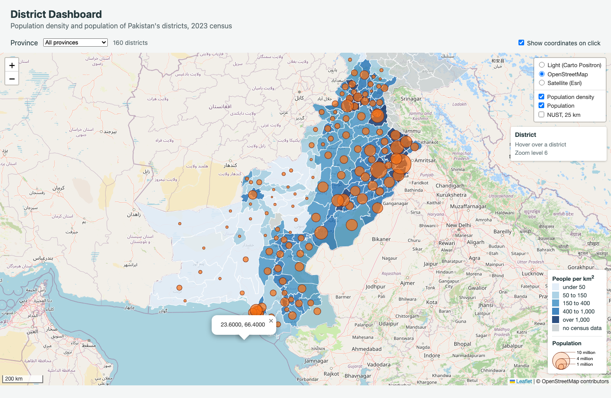

*The popup on the sea at 23.6000, 66.4000 — no district, so this is the map's
handler alone.*

**2. With the checkbox ticked, click the legend.**

No popup appears, because `legend.onAdd` ends with
`L.DomEvent.disableClickPropagation(div)`. With that line removed and the page
reloaded, clicking the legend **does** open a coordinate popup: the click
reaches the map container underneath and Leaflet treats it as a map click. The
line was put back.

This is the same mechanism as the info panel's `disableClickPropagation`, and it
is why both custom controls need it rather than either one. It also explains
what the method is really for: a control is a DOM element sitting on top of the
map, and without the call its clicks belong to the map as well.

**3. Untick the checkbox and click the sea.**

Nothing happens at all — no popup, no console output. `map.off('click',
showCoordinates)` really did remove the handler, which is the whole reason
`showCoordinates` has a name. Checked mechanically as well: with the box
unticked, firing a map click at 24.0, 67.0 leaves zero popups in the DOM, where
the ticked case leaves one.

The panel's zoom level is kept current by a `zoomend` handler calling
`info.update()`. `zoomend` fires once when a zoom finishes; `zoom` would fire
continuously through the animation and rebuild the panel's HTML on every frame.

---

## 8. Filter by province *(extension)*

`draw()` already filtered by province; Part 8 adds the drop-down. The list is
built from the data with `new Set(...)` rather than typed by hand, so it stays
correct if the data changes — 7 provinces, sorted, plus "All provinces".

**Checkpoint 8 — one province selected, layer control open**

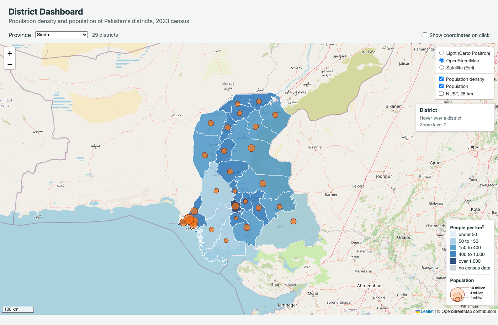

*Sindh, 29 districts, redrawn by `draw('Sindh')`. The overlays still switch the
rebuilt layers on and off, because the control holds `districtGroup` and
`circleGroup` rather than the `L.geoJSON` layers that `draw()` replaces.*

### Gilgit Baltistan: 14 districts and no circles

Selecting Gilgit Baltistan gives a count of 14 districts and draws no circles at
all. The reason is in the data rather than in the code: the 2023 census covered
the four provinces and the federal capital, and published nothing for Gilgit
Baltistan or Azad Kashmir. All 14 districts there have `pop_2023: null`, so
`hasPopulation` removes every one of them and the `circleGroup` comes out empty.
The same is true of Azad Kashmir's 10 districts, and of Lehri in Balochistan,
which is not listed separately in the census tables — 25 districts in all, the
ones drawn grey by `colourFor(null)`.

**Should the dashboard tell the user so? Yes, and it does.** As delivered, the
count reads `14 districts - no census data for Gilgit Baltistan, so no circles`.
Without that sentence the page looks broken rather than incomplete: the user
selects a province from a drop-down that the page itself built, and one of the
two overlays they can see ticked in the layer control silently draws nothing.
The grey districts are a *statement* — "no value recorded" — and the legend
explains grey, but an empty overlay has no such explanation on the map. The
principle is that a map which cannot show something should say so rather than
leave the reader to guess whether the data is missing or the code is wrong.
`reportEmptyProvince()` fires only when the selected province has no census
values at all, so the 135 districts that do have one are unaffected.

---

## 9. SVG or canvas *(extension)*

`const useCanvas = new URLSearchParams(window.location.search).has('canvas')` as
the first line, and `preferCanvas: useCanvas` in the map options, so
`index.html?canvas` draws every vector into a canvas while `index.html` still
uses SVG. `draw()` is timed with `performance.now()` and logs
`draw(all): 160 districts in 22.8 ms, SVG`.

Measured in Chrome, five reloads per renderer, window 1400 × 1000, reading the
time the page prints itself:

| | SVG | Canvas |
|---|---|---|
| `draw(all)`, five reloads (ms) | 31.6, 24.3, 22.1, 21.1, 22.8 | 21.7, 22.3, 32.0, 22.2, 22.4 |
| **median (ms)** | **22.8** | **22.3** |
| Elements inside `leaflet-overlay-pane` | **160 `<path>`** elements (135 more in the symbols pane) | **1 `<canvas>`** element (1 more in symbols) |
| Hover highlight still works? | yes | yes |
| Can you inspect one district in Elements? | yes — one `path.leaflet-interactive` per district, with its own `d` and `fill` | no — one canvas, pixels only, no per-feature element |

**Checkpoint 9 — the Elements tab in both modes**


*Chrome's Elements tab on `index.html`. The search box reads
`leaflet-overlay-pane`, 1 of 1, and the tree is expanded to
`div.leaflet-map-pane ▸ div.leaflet-overlay-pane ▸ svg.leaflet-zoom-animated` —
one `<svg>` element carrying every district and every circle. The console below
reads `draw(all): 160 districts in … SVG`.*

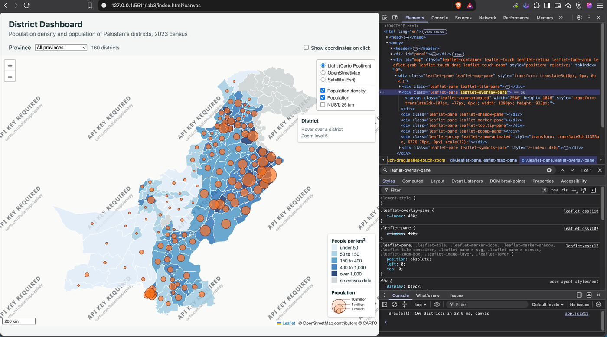

*The same panel on `index.html?canvas` — note the address bar. The same pane now
holds a single `<canvas class="leaflet-zoom-animated" width="2580" height="1846">`
and no SVG at all, and the console reads `draw(all): 160 districts in 23.9 ms,
canvas`. That contrast is the whole difference between the two rows of the table
above: 160 inspectable elements against one bitmap. The `404 (File not found)`
in the SVG shot's console is the Carto Positron basemap, the API-key problem
recorded in §0; it does not affect the renderer comparison.*

Both were captured from Chrome's Elements tab by hand. The panel's tree is
Lit-virtualised and would not take synthetic events, so
`lab3/capture_devtools_elements.mjs` reliably opened the panel, set the search
box and expanded down to the panes, but the disclosure clicks landed only about
one run in three — hence the manual captures.

**The two renderers are a tie, at 22.8 ms against 22.3 ms** — a 0.5 ms
difference, which is smaller than the spread within either set of five runs
(SVG's own five runs range from 21.1 to 31.6 ms). This is what the handout
predicts, and it is the interesting result rather than a disappointing one: at
160 districts and 135 circles, the number of features is nowhere near the point
where the renderer decides the cost. What canvas saves is per-feature DOM work,
and there is not yet enough of it to save anything. What it costs is immediate:
`?canvas` gives up per-district inspection in the Elements tab, and hovering is
now hit-tested against a bitmap instead of against elements.

For the **tehsil layer**, administrative level 3, I would expect canvas to win
clearly, and by more than the feature count alone suggests. The reasons compound:

- **Many more features.** Pakistan's admin-3 layer has several times the 160
  polygons, so the per-element DOM cost that SVG pays 160 times over, canvas
  pays once.
- **More vertices each.** Smaller units are not simpler; a tehsil boundary
  carries as much detail as the district it came from, so the `d` attribute of
  every SVG path gets longer while the number of paths grows too. The two
  multiply.
- **Re-styling is the expensive part.** This dashboard re-runs `styleFor` on
  every draw, and hover calls `setStyle` per feature. In SVG each of those is a
  DOM attribute write on a separate element, which also triggers style
  recalculation and repaint for that element. In canvas the whole layer is one
  element, redrawn as a unit.
- **The break-even the lecture gives** is a few thousand features, and admin 3
  is the first layer in this course that is firmly on the far side of it.

Against that, the two things canvas gives up matter more at tehsil scale, not
less: with several thousand polygons there is no way to inspect or select a
single one in the Elements tab, and per-feature tooltips and `bringToFront()`
stop being cheap. So I would expect canvas to be the right default for the
tehsil layer, and SVG to remain the better choice for anything small enough to
want to debug.

---

## 10. Publish and submit

```
cd webgis-lab-537865
git add -A
git commit -m "Lab 3: district dashboard"
git push
```

| | |
|---|---|
| Repository | https://github.com/zayd0123/webgis-lab-537865 |
| Lab 3, live | https://zayd0123.github.io/webgis-lab-537865/lab3/ |
| Lab 3, canvas | https://zayd0123.github.io/webgis-lab-537865/lab3/index.html?canvas |
| Lab 2, still at its old address | https://zayd0123.github.io/webgis-lab-537865/ |

Lab 2 was left in place at the repository root, so its published address is
unchanged.

---

## 11. Answers to the questions

### 1. Lab 2 shaded districts by population. Name one large, thinly populated district and one small, crowded one, and explain how each would mislead on the Lab 2 map.

**Chagai** (Balochistan) is the large, thinly populated one: **44,476.9 km²**,
**269,192 people**, **6.1 per km²**. **Central Karachi** (Sindh) is the small,
crowded one: **65.1 km²**, **3,822,325 people**, **58,715 per km²**.

Chagai is **683 times the area** of Central Karachi and holds **14 times fewer
people**, yet on the Lab 2 map it is the darkest thing on the page, sitting in
the top class above 3 million, while Central Karachi is pale. A reader takes the
darkest patch to mean "most people" or "worst problem", and both readings are
wrong: Chagai is dark because it is vast and almost empty. The shading is
essentially a map of district area wearing a population legend.

Central Karachi misleads the other way, and more damagingly, because the error
is invisible. The densest district in the country — 58,715 people per km²,
nearly eight times Lahore — is drawn in the lightest class, next to districts
with a fraction of its crowding. Nothing on the Lab 2 map suggests that
Pakistan's most intense concentration of people is anywhere in particular,
because a population count cannot distinguish 3.8 million people packed into 65
km² from 3.8 million spread over 40,000. That is the flaw the choropleth rule
exists to prevent: the variable behind the colour grew with the area being
coloured, so the colour ended up reporting the area.

### 2. `radiusFor` takes a square root. What would the map suggest about Lahore against a district of 3 million if it did not?

Lahore has **13,004,135** people and a 3-million district has **4.33 times
fewer**. As drawn, with `Math.sqrt(population) / 160`, Lahore's radius is
**2.08 times** the smaller district's, and since area goes with the square of the
radius, Lahore's circle has **4.33 times the area** — exactly the ratio of the
populations. That is the reading the legend promises.

If the radius followed population directly, Lahore's radius would be **4.33
times** the other's, and its area would be **18.8 times** as large. The map
would claim Lahore holds nearly nineteen times as many people as a district it
holds four and a bit times as many people as. The error is not a rounding
problem: it inflates every large district by its own population ratio, so the
biggest city on the map is overstated worst, and the map goes from reporting a
ratio to reporting the square of a ratio. Squaring the reader's visual comparison
is exactly what the square root undoes.

### 3. Why does the layer control hold `districtGroup` rather than the `L.geoJSON` layer itself?

Because `draw()` **replaces** the `L.geoJSON` layer every time the province
changes, while the control's reference to a layer is fixed at the moment it is
added. `L.control.layers` stores the layer object it was handed and toggles that
object on and off. If it were handed the `L.geoJSON` layer, then:

- the first `draw('all')` would put a layer in the control that is current;
- the first province change would build a **new** `L.geoJSON` layer, add it to
  the map, and discard the old one — but the control would still be holding the
  old one, now removed from the map;
- unticking "Population density" would then remove a layer that is not on the
  map, and ticking it would add it *back*, drawing the previous province's
  districts over the current ones.

`L.featureGroup()` stays the same object for the life of the page and its
*contents* are what change, so the control's checkbox and the layer on the map
never disagree. Checked directly: after switching to Punjab, ticking and
unticking the "Population density" overlay still removes and restores the
36-district layer that `draw('Punjab')` had just built.

### 4. What would go wrong if the circles were drawn in `overlayPane` instead of the symbols pane? Describe what the user would see when hovering.

Polygons and `circleMarker`s are both vector paths, and Leaflet draws them into
the same pane in the order they were added. `overlayPane` holds both, so the
first symptom is that **the circles are buried**: the district layer is added
first, so the polygons are painted over the circles and a district with no
population value can hide the circles of the districts near it.

Hovering is what makes it visibly wrong, and the cause is `bringToFront()` in
`highlight()`. That method lifts the hovered path to the end of its pane's
child list so its thick outline is not clipped by its neighbours. When the
circles are in the same pane, that reordering also lifts the hovered *polygon*
above the circles, so:

- **the circle for the district being hovered disappears**, because the
  district's own polygon has just been moved in front of it, and it reappears
  when the pointer leaves and the polygon is left where it was;
- the district's **fill is drawn over the neighbouring districts' circles**
  where they overlap it, so circles blink out one at a time as the pointer
  crosses the map, and come back in a different order;
- the effect is worse the more the pointer moves, because each hover adds
  another reordering, and the map ends up in a draw order that depends on the
  path the mouse happened to take rather than on the data.

None of this is a styling problem that can be fixed with `fillOpacity`: it is
draw order, and at 400 the polygons and the circles are competing for the same
layer. Giving the circles their own pane at 450 fixes it once, for every feature,
regardless of what the pointer does.

### 5. Why can `map.off` remove `showCoordinates`, when it could not remove an anonymous function passed to `map.on`?

Because Leaflet keeps handlers in a list on the object, and `off` removes an
entry by comparing the function it is given against the functions in that list —
by **identity**, with `===`. A named function is a value held in a variable, so
the same function object can be handed to `on` and later to `off`, and the two
references are equal. `showCoordinates` is declared once, so both calls see the
identical object.

An anonymous `function (e) { ... }` written inline in a call to `on` creates a
new function object and then throws away every reference to it. The handler is
registered and works, but nothing in the program can name it again. A later
`off` would have to pass a *different* function object — even an identical-looking
one, since two function literals with the same body are still different objects —
so the comparison fails, nothing is removed, and the handler stays attached for
the life of the page. It is the classic observer leak: the only way to unregister
is to have kept the reference. Hence the rule that a handler which will ever need
removing gets a name (or is stored in a variable) at the moment it is registered,
which is also why `highlight`, `unhighlight` and `zoomToDistrict` are declared
separately rather than written inline in `layer.on`.

### 6. On the NUST overlay, which circle would you use to show a 25 km evacuation zone, and which to mark the campus on a national map? Why?

**The 25 km evacuation zone: `L.circle`, the one taking metres.** An evacuation
zone is a distance on the ground, and the whole point of drawing it is that it
stays the same size relative to the terrain as the reader zooms. A radius of
25,000 m covers 25 km of Pakistan at every zoom, and it measures correctly
against the scale bar — verified at zoom 10, where the circle is 394 px across
and the scale bar reads 10 km, so the circle spans a little over two and a half
bars, which is the 25 km it claims. If the zone were drawn in pixels, the same
symbol would mean a different distance on every screen and at every zoom, and a
reader comparing it to a road or a river would get the wrong answer about who is
inside it.

**The campus on a national map: `L.circleMarker`, the one taking pixels.** At
zoom 5 the whole country is on screen and 25 km is a fraction of a millimetre —
a `L.circle` for the campus would be sub-pixel and invisible, and even the 25 km
circle is only 12 px across. A 6 px `circleMarker` is a legible dot at that
scale, and its job there is only to say *where* the campus is, not how big it
is. Because it is in pixels it stays 6 px at zoom 5, at zoom 10 and at zoom 14,
which is what a location marker should do.

The two constructors answer different questions. `L.circle` says "this much
ground"; `L.circleMarker` says "this point, visible now". A quantity that is a
distance belongs on the first; a point of interest that has no extent at the
scale being drawn belongs on the second. Drawing the campus with `L.circle`
would make it vanish when zoomed out; drawing the evacuation zone with
`L.circleMarker` would make it lie about distance. The overlay deliberately
holds one of each on the same coordinate so the two behaviours can be compared
side by side — the measurements are in §6.

---

## Files added by this lab

| Path | What it is |
|---|---|
| `lab3/index.html` | the page structure |
| `lab3/style.css` | page and control styling |
| `lab3/app.js` | the dashboard, blocks labelled by Part |
| `lab3/data/districts.geojson` | 160 districts (copied from Lab 2) |
| `lab3/data/district_points.geojson` | 160 district points, from QGIS `native:pointonsurface` |
| `lab3/data/qgis_centroids.geojson`, `qgis_point_on_surface.geojson` | the two QGIS tools' own output |
| `lab3/make_point_layer_qgis.py` | rebuilds the point layer in QGIS |
| `lab3/qgis_part2.py` | runs both QGIS tools and exports the print-layout figure |
| `lab3/qgis_project_setup.py` | writes the two QGIS projects |
| `lab3/capture_qgis_app.sh` | captures Checkpoint 2 from the QGIS application |
| `lab3/sibi_centroid_comparison.qgz` | QGIS project, print layout |
| `lab3/sibi_centroid_map_view.qgz` | QGIS project, canvas zoomed to Sibi |
| `lab3/check_point_layer.py` | prints the Sibi evidence |
| `lab3/make_sibi_figure.py` | the matplotlib version of the centroid figure |
| `lab3/check_dashboard.mjs` | 43 automated checks in headless Chrome |
| `lab3/measure_renderers.mjs` | the Part 9 SVG/canvas measurements |
| `lab3/capture_screenshots.mjs` | captures the map figures in this report |
| `lab3/capture_devtools_network.mjs` | captures Checkpoint 3 from Chrome's Network tab |
| `lab3/capture_vscode_folder.sh` | captures Checkpoint 1 from VS Code |
| `lab3/QGIS.md` | the Part 2 QGIS work, the GUI route, and the QGIS 4 findings |
| `lab3/Report/` | the figures |

The three `.mjs` scripts drive real Chrome over the DevTools protocol and need
only Node — no packages. They were used to check the dashboard and take the
figures, and can be re-run:

```
python3 -m http.server 5511          # from the repository root
node lab3/check_dashboard.mjs        # 43/43 checks
node lab3/measure_renderers.mjs      # the Part 9 table
node lab3/capture_screenshots.mjs    # the figures
```
