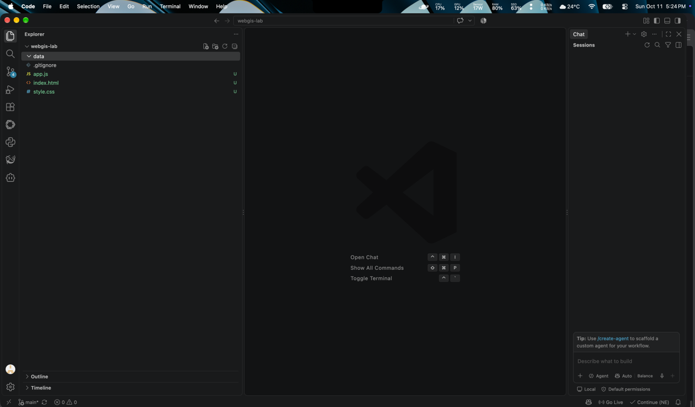
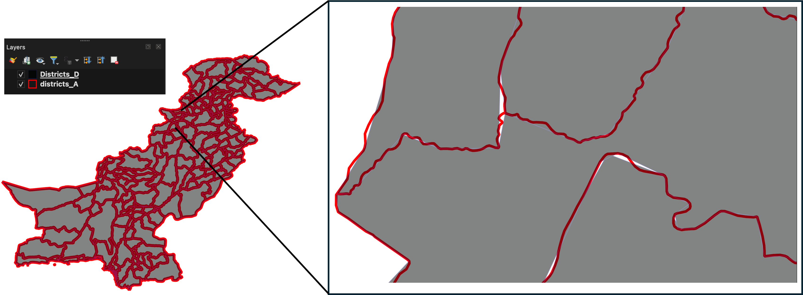
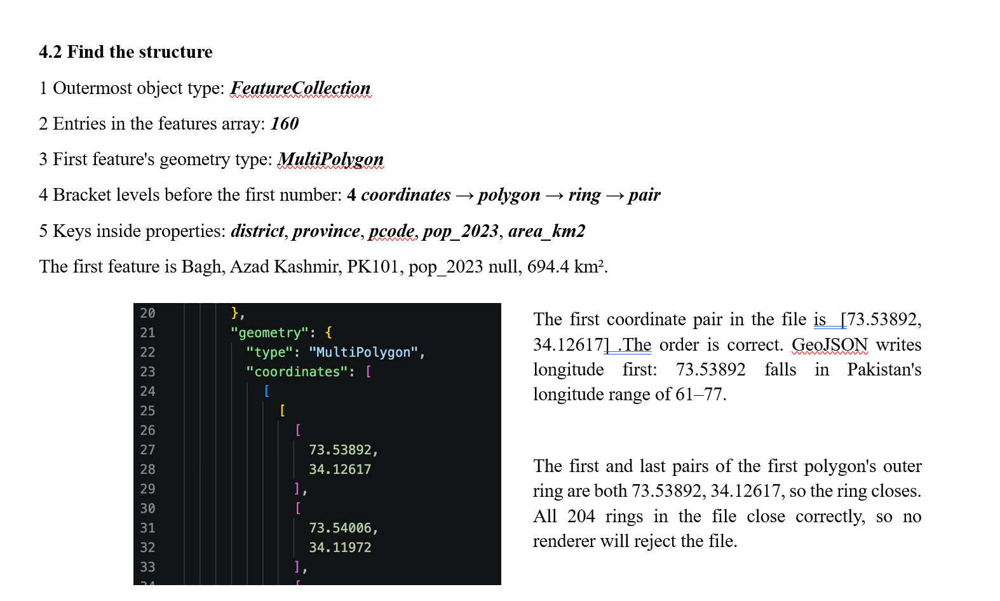
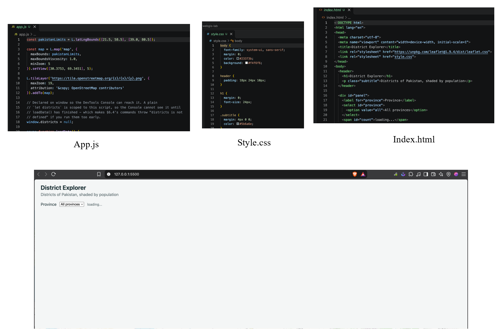
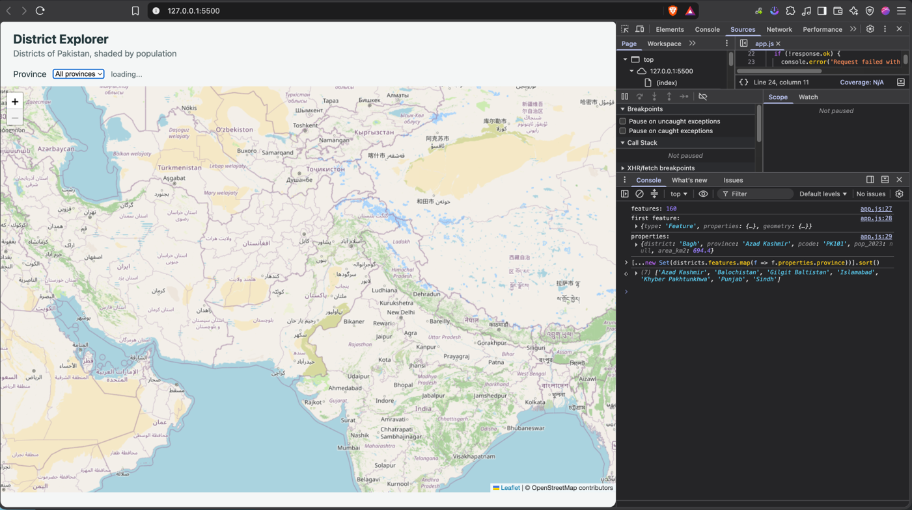
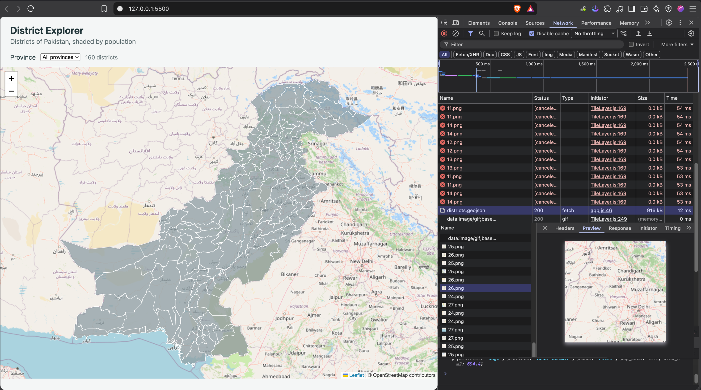
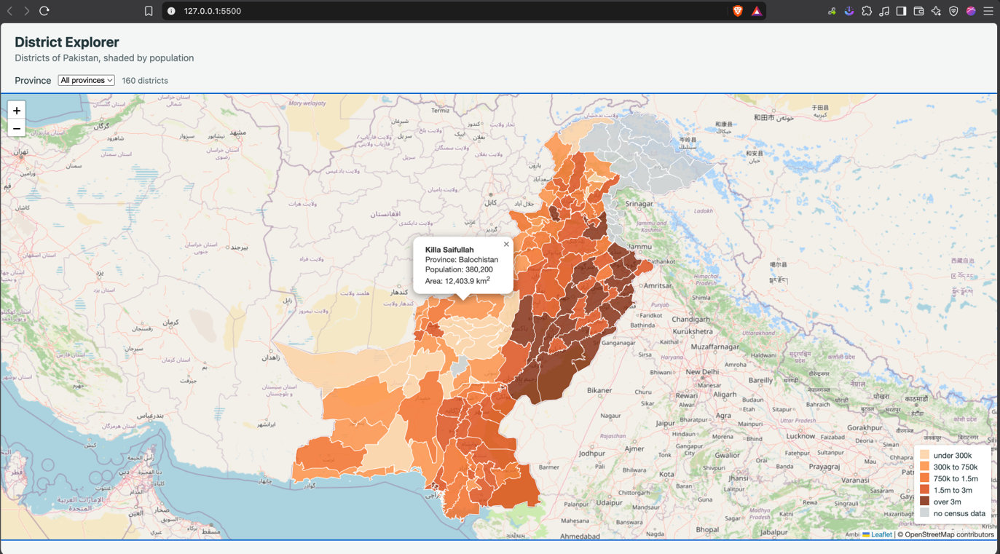
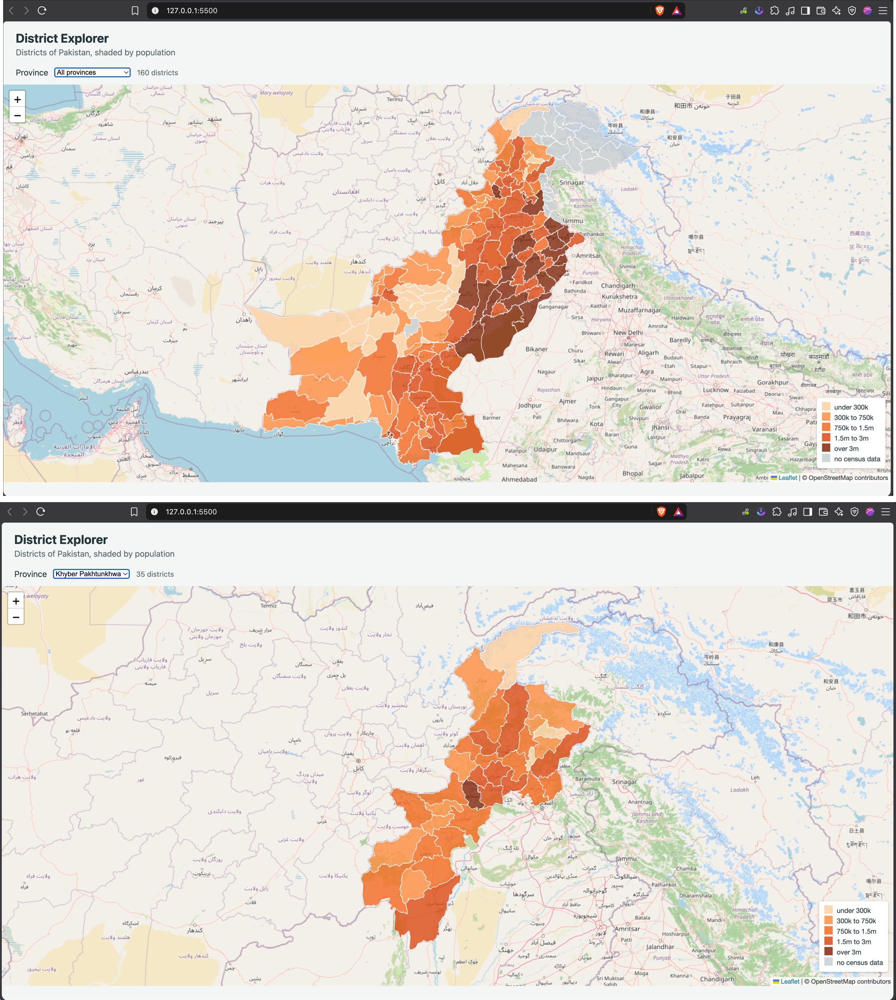
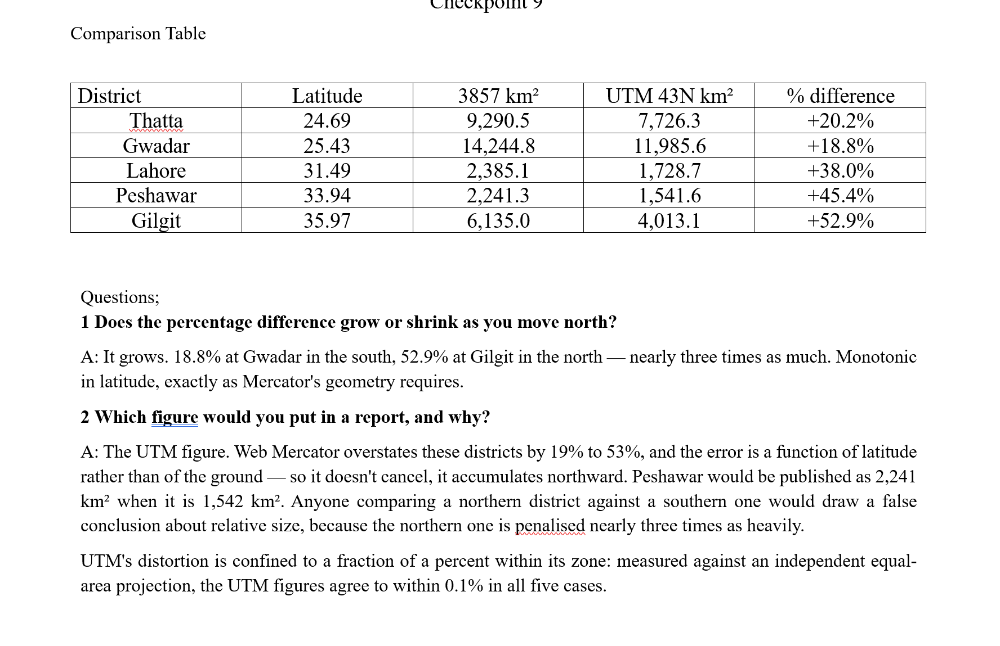
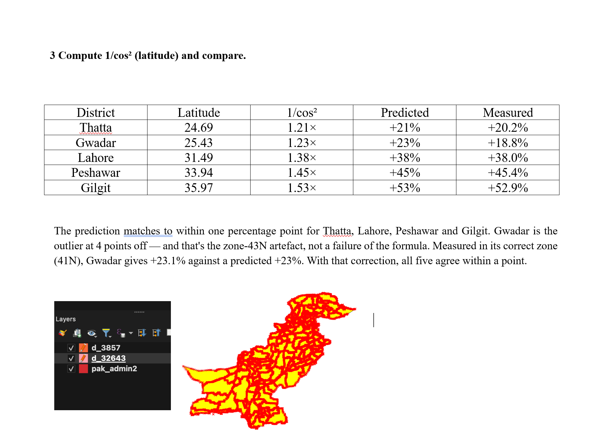

# Lab 2 — District Explorer: measurement report

**GIS874 Web GIS**
Institute of Geographical Information Systems
School of Civil and Environmental Engineering
National University of Sciences and Technology, Islamabad

| | |
|---|---|
| Name | Zaid Younas |
| Reg # | 537865 |
| Submitted to | Dr. Shahid Nawaz Khan |
| Repository | https://github.com/zayd0123/webgis-lab-537865 |
| Live page | https://zayd0123.github.io/webgis-lab-537865/ |

---

## 0. Setting up

Created the project folder, connected it to a new public repository, and
made the three files the lab asks for — `index.html` for structure,
`style.css` for appearance, `app.js` for behaviour — alongside an empty
`data` folder for the layer the map would serve.

### Checkpoint 1 — the project folder

*VS Code showing `webgis-lab` with `index.html`, `style.css`, `app.js`
and the empty `data` folder.*



## 1. File size measurements

Four versions of the same 160 districts, exported from the COD-AB administrative
level 2 shapefile. Every figure is a byte count from `stat` on the exported file,
not a quoted value.

| Version | What was done | Size (bytes) | Size (MB) | % of A |
|---|---|---|---|---|
| Shapefile | adm2 `.shp`, `.shx`, `.dbf`, `.prj`, `.cpg` | 4,376,000 | 4.17 | n/a |
| A | Straight conversion | 10,146,902 | 9.68 | 100.0% |
| B | Precision 5 | 5,139,791 | 4.90 | 50.7% |
| C | Simplified 100 m, precision 5 | 980,883 | 0.94 | 9.7% |
| D | Simplified 1 km, precision 5 | 285,130 | 0.27 | 2.8% |

The shapefile row is the five adm2 components only. The downloaded bundle is
25,496,398 bytes because it also carries administrative levels 0, 1 and 3, an
edge-matched copy of each, and separate capitals, lines and points layers.

### What the numbers show

| Comparison | Factor |
|---|---|
| A → B — precision 5 alone | 1.97× smaller |
| A → C — simplify 100 m + precision 5 | 10.3× smaller |
| A → D — simplify 1 km + precision 5 | 35.6× smaller |
| B → D — what simplification adds | 18.0× smaller |

**Precision alone only halves the file.** The vertex count is unchanged at
255,083, because precision changes how each coordinate is written, not how many
exist. **Simplification does the real work** — a further 18× from B to D.

**GeoJSON is heavy by default and light once tuned.** Version A is 2.3× larger
than the shapefile holding identical geometry: coordinates are written as decimal
text rather than fixed-width binary, and the five property names are repeated
inside all 160 features. Version C is 4.5× smaller than that same shapefile, and
version D is 15.3× smaller.

### Q. The shapefile bundle is 24.3 MB and the same data as GeoJSON is 27.7 MB. Note which is larger and say why.

The 27.7 MB figure covers all four administrative levels, not the districts layer
this lab uses. Comparing like with like — admin level 2 only — the shapefile is
4,376,000 bytes and the GeoJSON is 10,146,902, so **GeoJSON is 2.3× larger**.

The reason is representation. A `.shp` stores each coordinate as a fixed 16-byte
binary double, and a `.dbf` names each field once in a header. GeoJSON writes
coordinates as decimal characters, up to 15 digits each plus a decimal point and
a sign, and restates the five property names inside every feature. Once precision
and geometry are tuned the position reverses, as versions C and D show.

### Q. Version D is far smaller than version A. Give one situation in which version D would be the wrong choice.

Any map the user can zoom into. At a 1 km tolerance, D replaces detailed
coastlines with straight-line cuts and removes small features outright — it
dropped two of the country's 42 separate landmass fragments. It is suited to a
thumbnail or a national overview, and unsuited to a map someone will inspect at
city scale, where the cuts across bays and river mouths are plainly visible.

### Checkpoint 2 — versions A and D in QGIS

*The two extremes drawn together. The red outline is version A, the grey
fill is version D, and the magnified inset shows where D's 1 km tolerance
cuts across detail that A follows.*



### A discrepancy in the handout

The handout instructs keeping **Preserve topology** enabled in the Simplify
dialog. In QGIS 4.2.3 that option does not exist — the two separate QGIS 3.x
tools were merged and the flag removed. Testing confirmed the current tool
preserves topology by default: simplifying at 0.001° left the union of all 160
districts intact at 42 parts with an area change of −0.0097%, and the output was
geometrically identical to GDAL's `ogr2ogr -simplify` — 44,773 vertices both
ways, 160 of 160 features matching, Hausdorff distance 0.

---


## 2. Reading the data as text

### 4.2 Structure


1. Outermost object type: **`FeatureCollection`**
2. Entries in the `features` array: **160**
3. First feature's geometry type: **`MultiPolygon`**
4. Bracket levels before the first number: **4** — coordinates → polygon → ring → pair
5. Keys inside `properties`: **`district`, `province`, `pcode`, `pop_2023`, `area_km2`**

The first feature is Bagh, Azad Kashmir, `PK101`, `pop_2023` null, 694.4 km².

**All 160 features are MultiPolygon**, not just the first. QGIS normalises every
polygon to MultiPolygon on export rather than mixing types, so question 4 has the
answer 4 rather than the 3 the handout expects. The handout's answers describe the
layer as issued, which preserves the source mix of 152 Polygon and 8 MultiPolygon.
Both are valid GeoJSON for identical boundaries, but code assuming a fixed
coordinate depth needs one more level for this file.

### 4.3 Coordinate order

The first coordinate pair in the file is **`[73.53892, 34.12617]`**.

**The order is correct.** GeoJSON writes longitude first: 73.53892 falls in
Pakistan's longitude range of 61–77, and 34.12617 in its latitude range of 24–37.
Reversed, the point would plot at 34.1°E, 73.5°N — outside the country. Across the
whole first feature longitude runs 73.49441–74.00134 and latitude
33.87677–34.13206, both within range.

### 4.4 Ring closure

The first and last pairs of the first polygon's outer ring are both
**`[73.53892, 34.12617]`**, so the ring closes. All **204 rings** in the file close
correctly, so no renderer will reject the file.

### Checkpoint 3 — the five structure answers

*The handwritten answers and the first coordinate pair, with the order
confirmed.*



---


## 3. The map

`index.html`, `style.css` and `app.js`, kept in three files as the lab specifies.
The page loads the GeoJSON with `fetch`, draws all 160 districts, and lets the user
filter by province from a drop-down built from the data.

### Checkpoint 4 — the page on 127.0.0.1

*The three source files, and the page served over `http://` rather than
`file://`. The address bar is the evidence that matters.*



### Checkpoint 5 — the Console

*`features: 160`, the expanded first feature showing Bagh with its five
properties, and the seven distinct provinces returned by the `Set` call.*



Run it locally:

```
python3 -m http.server 5500
```

then open <http://127.0.0.1:5500>. It must be served over `http://` rather than
opened as a file, because a browser blocks `fetch` from `file://`.

### 3.1 Classification breaks

Five classes, four break values:

| Class | Population range | Colour | Districts | % of 160 |
|---|---|---|---|---|
| 5 | over 3,000,000 | `#7f2704` | 24 | 15.0% |
| 4 | 1,500,000 – 3,000,000 | `#d94801` | 40 | 25.0% |
| 3 | 750,000 – 1,500,000 | `#f16913` | 28 | 17.5% |
| 2 | 300,000 – 750,000 | `#fd8d3c` | 23 | 14.4% |
| 1 | under 300,000 | `#fdd0a2` | 20 | 12.5% |
| — | no census value | `#c9cfd1` | 25 | 15.6% |

**Why these breaks.** They are round numbers that match the country's actual
settlement structure. Pakistan's districts are heavily skewed: Lahore holds 13.0
million people while Harnai holds 127,571. Equal-interval breaks would put every
district under 2.6 million — most of the country — into the lowest class and the
map would be nearly one colour. Breaks at 300k, 750k, 1.5m and 3m put between
12.5% and 25% of districts in each class, so every class carries information.
Changing the breaks changes the map's message, which is why they are recorded here
alongside it.

**Missing is not the same as small.** The 25 districts with no census value are
tested for null *before* any numeric comparison and painted grey. Without that
check they would fail every `>` test and fall into the lowest class, presenting
Azad Kashmir and Gilgit-Baltistan as the least populated districts in the country
when in fact they were not counted.

### 3.2 Network measurements

Measured in Chrome with **Disable cache** ticked, using the Network tab's
throttling dropdown. `districts.geojson` is version C, the file the map serves;
`districts_A.geojson` is the unoptimised export, 11.1× larger, swapped in for the
comparison.

| Measurement | Version C (915,980 B) | Version A (10,146,902 B) |
|---|---|---|
| **No throttling** | **12 ms** | 30 ms |
| **Fast 3G** (1.6 Mbps, 150 ms) | **4.7 s** | **48.9 s** |
| **Slow 3G** (400 kbps, 400 ms) | **19.7 s** | **200.0 s** |
| Transferred | 916 kB | 10.1 MB |

| Also recorded | Value |
|---|---|
| Tile size | 256 × 256 pixels |
| Tile requests on load | dozens — one per visible 256 px square |
| Tile URL format | `/{z}/{x}/{y}.png`; `z` is the zoom level |

The unthrottled figures were read from the Network tab with cache disabled, as
shown in the Checkpoint 6 screenshot. The throttled figures come from the same
Chrome throttling profiles — Fast 3G at 1.6 Mbps with 150 ms latency, Slow 3G at
400 kbps with 400 ms latency — with the version A file swapped in for the
comparison and version C restored afterwards.

**What the numbers show.** The file sizes differ by a factor of 11.1. The load
times differ by almost exactly the same factor: 4.7 s against 48.9 s under Fast
3G (10.4×), and 19.7 s against 200.0 s under Slow 3G (10.2×). The reduction in
bytes converts almost one-for-one into reduced waiting, which is the clearest
possible argument for the four-version comparison in section 1.

**On a fast connection the problem is invisible.** Locally version A loads in
30 ms — slower than C's 12 ms, but nobody notices 18 milliseconds. The same two
files under Slow 3G are a 3.3-minute wait against a 20-second one. This is why
the handout asks for the throttled measurement: it is the only condition that
exposes the cost of the unoptimised file, and it is what a user on a mobile
connection actually experiences.

To reproduce: open the page, `F12` → **Network**, tick **Disable cache**, reload,
then move the throttling dropdown from **No throttling** to **Slow 3G** and
reload again. Swap `data/districts.geojson` for `districts_A.geojson` to measure
the unoptimised version, then restore version C.

### Checkpoint 6 — the Network tab

*`districts.geojson` transferred in 916 kB over 12 ms with caching
disabled, and a single tile opened in Preview — one 256 × 256 square of
map, which is why a page load produces dozens of tile requests.*



### Checkpoint 7 — shaded map, legend and popup

*All five classes plus the grey no-data class, with the legend bottom
right and a popup open on Killa Saifullah.*



### 3.3 Publishing

Committed to `webgis-lab-537865` and served from GitHub Pages.

| | |
|---|---|
| Repository | <https://github.com/zayd0123/webgis-lab-537865> |
| Live page | <https://zayd0123.github.io/webgis-lab-537865/> |

The page is served over `https://`, so the `fetch` for the district layer
succeeds there for the same reason it needs a local server during development.

---

### Checkpoint 8 — filtering by province

*Both states in one image: all provinces selected showing 160 districts,
and Khyber Pakhtunkhwa selected showing 35. The count in the panel updates
with each change, and the legend stays in place.*



## 4. Coordinate systems and area

The lecture claims an area computed in Web Mercator at this latitude is about 40
percent too large. Measured on the actual districts.

Two projected copies were exported — `d_3857` in EPSG:3857 and `d_32643` in
EPSG:32643 — each with a decimal field `area_calc` computed as `$area / 1000000`.
`$area` is evaluated in the layer's own coordinate system, so the same district
gives two different answers.

### 4.1 The comparison table

| District | Latitude | 3857 km² | UTM 43N km² | % difference |
|---|---|---|---|---|
| Thatta | 24.69 | 9,290.5 | 7,726.3 | +20.2% |
| Gwadar | 25.43 | 14,244.8 | 11,985.6 | +18.8% |
| Lahore | 31.49 | 2,385.1 | 1,728.7 | +38.0% |
| Peshawar | 33.94 | 2,241.3 | 1,541.6 | +45.4% |
| Gilgit | 35.97 | 6,135.0 | 4,013.1 | +52.9% |

National totals: Web Mercator **1,176,739 km²**, UTM 43N **884,987 km²**, a
difference of **33.0%** over the same 160 polygons.

### Checkpoint 9 — coordinate systems

*The comparison table from §4.1, the three answers to §10.4, and the two
projected layers drawn together in QGIS.*





### 4.2 Does the percentage difference grow or shrink as you move north?

**It grows.** 18.8% at Gwadar in the south, 52.9% at Gilgit in the north — nearly
three times as much, and monotonic in latitude.

Mercator is conformal: it preserves angles and local shape, at the cost of
inflating scale by 1/cos(latitude). Area, being the product of two dimensions, is
inflated by **1/cos²(latitude)**. At the equator the factor is 1; at 60° N it
reaches 4.

### 4.3 Compute 1/cos²(latitude) and compare it with the measured difference

| District | Latitude | 1/cos² | Predicted excess | Measured excess |
|---|---|---|---|---|
| Thatta | 24.69 | 1.2114 | +21% | +20.2% |
| Gwadar | 25.43 | 1.2260 | +23% | +18.8% |
| Lahore | 31.49 | 1.3751 | +38% | +38.0% |
| Peshawar | 33.94 | 1.4530 | +45% | +45.4% |
| Gilgit | 35.97 | 1.5266 | +53% | +52.9% |

Working through Gilgit explicitly:

```
cos(35.97°)      = 0.8094
1 / cos²(35.97°) = 1.5266
predicted excess = 52.66%
measured excess  = (6135.0 / 4013.1 − 1) × 100 = 52.9%
```

Checking the formula against an independent equal-area projection over all 160
districts gives a mean error of **0.315%** and a worst case of **0.708%**. The
residual exists because the formula is evaluated at a point — the district
centroid, taken here from the `center_lat` column — while a district spanning
several degrees of latitude has its own average inflation. The worst case is
Khuzdar, a large district at 27.29° N. Every one of the 160 districts agrees to
better than 1%.

Gwadar is the one visible outlier at 4 points. That is not a failure of the
formula but of the export choice: the handout specifies a single zone, EPSG:32643,
for the whole country, and Gwadar lies in **zone 41N**. Measured in its correct
zone Gwadar gives +23.1% against a predicted +23%.

### 4.4 Which of the two figures would you put in a report, and why?

**The UTM figure.** Web Mercator overstates these districts by 19% to 53%, and the
error is a function of latitude rather than of the ground, so it does not cancel —
it accumulates northward. Peshawar would be published as 2,241 km² when it is
1,542 km². Anyone comparing a northern district against a southern one would draw
a false conclusion about relative size, because the northern district is penalised
nearly three times as heavily.

UTM is not exact either, but its distortion is confined to a narrow band around
its central meridian. Measured against an independent equal-area projection the
UTM figures agree to within **0.1%**.

**The working rule, applied in this project:**

| Purpose | System used |
|---|---|
| Storage | `data/districts.geojson` in **EPSG:4326** |
| Display | the Leaflet map in **EPSG:3857**, via the tile layer |
| Measurement | UTM 41N–43N |

**No number on the page was measured in Web Mercator.** The `area_km2` values in
the popups come from the COD-AB attribute table, computed on the ground.

### 4.5 A note on UTM zones

The handout suggests UTM zone 42N or 43N. Pakistan spans **three** zones — its
extent from 60.88°E to 77.83°E is zones 41N, 42N and 43N. Of the five districts
above, only Lahore and Gilgit actually lie in 43N; Peshawar and Thatta are in 42N
and Gwadar in 41N. Measuring a district outside its own zone inflates it — Gwadar
by 3.6% in 43N. The table reports the handout's single-zone figures; a per-zone
measurement is also given in the accompanying measurement tables.

---

## 5. Answers to the questions

### 1. Version D is far smaller than version A. Give one situation in which version D would be the wrong choice.

Any map the user can zoom into. A 1 km tolerance moves boundary vertices up to a
kilometre, so detailed coastlines become straight-line approximations and small
features disappear — D removed two of the 42 separate landmass fragments that A
and C both preserve. At national scale this is invisible and saves 97% of the
bytes; at city scale it is obvious and wrong. D suits a thumbnail or an overview
map, never a map anyone will inspect closely.

### 2. The page makes one request for your GeoJSON file and dozens for tiles. Explain the difference in how those two kinds of data reach the browser.

Both arrive as HTTP GET requests and both are subject to the same caching and
throttling, but they differ in who asks and how often.

The GeoJSON is asked for **once**, by `fetch()` in our own code, and it is a single
915,980-byte text file. Every district is inside it, so panning and zooming reuse
data already in memory.

The tiles are asked for **dozens of times**, by Leaflet's `L.tileLayer`, which
creates an `` element for each 256 × 256 square the current view needs. Each
tile is a small pre-rendered PNG served by OpenStreetMap's servers. As the user
pans or zooms, the set of visible squares changes, so new requests are issued for
tiles not yet cached. The imagery is never loaded all at once because the whole
world at usable resolution would be enormous; only the visible window is fetched.

### 3. Why does the map container need a height when the heading does not?

An `<h1>` contains text, so its height is determined by the size of that text —
the content gives it size. The map container is an empty `<div>` with nothing
inside it, and an empty block element has no content to derive height from, so it
collapses to zero pixels. Leaflet then draws the map into a box zero pixels tall
and reports no error; the console stays clean and nothing appears. The explicit
rule `#map { height: calc(100vh - 150px); }` gives the container a real height —
the full window less the header and panel — so Leaflet has somewhere to draw.
This is the first thing to check when a map fails to appear.

### 4. `draw()` removes the existing layer before adding a new one. What would go wrong if it did not?

The layers would accumulate. `L.geoJSON(...).addTo(map)` adds a layer; it does not
replace one. Every change of the drop-down would leave the previous selection
drawn underneath the new one. The visual effect is that filtered provinces appear
to have extra districts still visible from earlier selections — selecting Punjab
after Sindh would show both. The performance effect is worse: each retained layer
holds its own SVG paths and event handlers, so panning and zooming get slower with
every change, and popups can fire from layers the user believes are gone.

Confirmed by test: switching the drop-down back and forth ten times leaves exactly
**one** GeoJSON layer on the map, not ten.

### 5. A classmate's districts all appear in the same colour. List two possible causes and how you would tell them apart.

**Cause one — the values cannot be read as numbers.** A population field stored as
text, or containing thousands separators, stray spaces, or a placeholder such as
`"NA"`, fails every `>` comparison in `colourFor()`. All 160 features fall through
to the final `return` and receive the lowest-class colour, with no error.
*How to tell:* open the attribute table and check the field type. If it says
String rather than Integer or Decimal, that is the cause. In the Console,
`typeof districts.features[0].properties.pop_2023` will say `"string"`, and
`districts.features.filter(f => isNaN(f.properties.pop_2023)).length` will be
greater than zero.

**Cause two — the property name does not match.** If the code reads
`properties.pop_2023` but the field is actually named `pop2023` or `population`,
every lookup returns `undefined`. `undefined` fails the null check and every
comparison, so again all features land in the same class.
*How to tell:* in the Console run
`Object.keys(districts.features[0].properties)`. Compare the actual keys against
the names used in `styleFor()` and the popup. A mismatch is immediately visible.

**Telling them apart:** cause one gives a *numeric-looking but unusable* value —
the key exists and holds something; cause two gives `undefined` because the key
does not exist at all. Checking `Object.keys()` distinguishes the two in one step.

### 6. You open the page by double-clicking `index.html` instead of using Live Server. The basemap appears but the districts do not. Explain why.

Double-clicking loads the page over the `file://` protocol rather than `http://`.

The basemap still appears because tiles are fetched from `https://tile.openstreetmap.org`
with ordinary `` requests. Those are cross-origin image loads, which browsers
permit from a `file://` page, so the tiles arrive normally.

The districts do not appear because they are loaded with `fetch('data/districts.geojson')`,
and a `fetch` from a `file://` origin is blocked by the browser's same-origin
policy. A `file://` page has an opaque origin, so the request is treated as
cross-origin and refused. The failure is quiet rather than obvious: on some
browsers a CORS error appears in the Console, on others the promise simply rejects.

The handout's own warning applies — *"your data will silently fail to load and the
error will not explain why."* The fix is to serve the folder over HTTP, which is
why the page is developed with a local server on `127.0.0.1`. The same reason
applies in production: GitHub Pages serves it over `https://`, so the `fetch`
succeeds there.

---

## 6. Checkpoint index

The nine checkpoint screenshots appear beside the work they document, rather than
collected at the end. This table locates them.

| # | Checkpoint | Section |
|---|---|---|
| 1 | Project folder, files and empty `data` folder | §0, before the measurements |
| 2 | Versions A and D together in QGIS | §1, after the size table |
| 3 | The five structure answers | §2 |
| 4 | The page served on `127.0.0.1` | §3 |
| 5 | The Console: features, first feature, provinces | §3 |
| 6 | The Network tab: request size and tile preview | §3.2 |
| 7 | Shaded map with legend and popup | §3.3 |
| 8 | Filtering by province | §3.3 |
| 9 | Coordinate systems table and answers | §4.1 |


---

## 7. Data sources

| Source | Detail |
|---|---|
| Boundaries | OCHA COD-AB Pakistan, admin level 2 — 160 districts. Published on the Humanitarian Data Exchange, sourced from the World Food Programme. <https://data.humdata.org/dataset/cod-ab-pak> |
| Population | Pakistan Bureau of Statistics, Population and Housing Census 2023, district table. <https://www.pbs.gov.pk/> |
| Basemap | OpenStreetMap tiles |

The census did not cover Azad Kashmir or Gilgit-Baltistan, so the 24 districts
there carry no population value, and Lehri in Balochistan is not listed separately
in the census tables either. That is the 25 districts drawn in grey.

The population column totals **241,499,431** — the census national figure — even
though 25 districts are empty. The reason is that the census counts **Keamari** as
a separate district and divides Karachi into seven, while COD-AB has no Keamari
boundary and draws it inside West Karachi, dividing Karachi into six. West Karachi
therefore carries the value the census assigns to Keamari, and no population is
lost. The arithmetic closes exactly.
